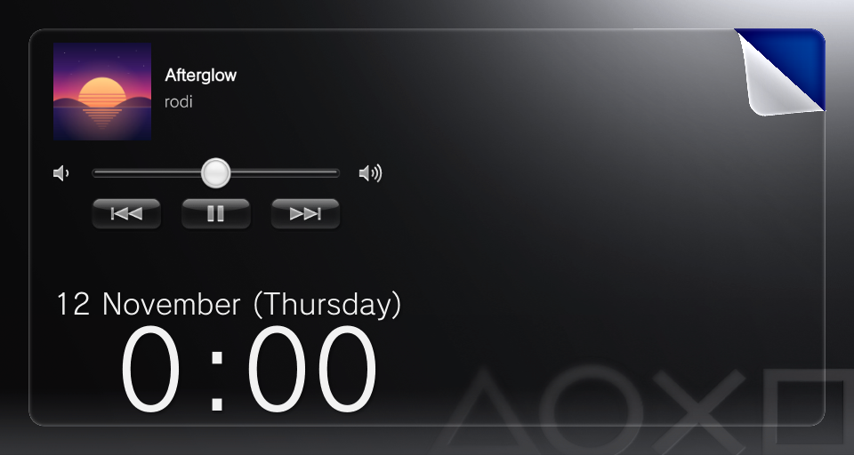

# Start Screen Music for PS Vita

Music controls on the PS Vita's start screen (lock screen), built from the Vita's own parts. PS Vita plugin by rodi.



While a song is playing or paused in the Music app, the start screen shows the song's cover, title and artist, a volume bar, and previous / play / next. It is the Quick Menu's own Music row, laid out above the clock. Like the clock, it is simply there when the screen lights up, and a new song's title and cover replace the old ones the way the Quick Menu's do. When the Music app closes, it goes.

Everything on it is Sony's, read from the Vita while it runs; nothing of Sony's ships with the plugin:

- the buttons, icons, volume bar and text styles: the Quick Menu's Music row (`vs0:vsh/shell/impose_plugin.rco`), in the system font;
- "Unknown" for a song without a title or artist: the Quick Menu's own string, in all 20 of the Vita's languages;
- the square for a song without a cover: the Music app's own (`vs0:app/NPXS10009/musicbrowser_plugin.rco`);
- the layout: the start screen's own margins (the cover's left edge on the speaker line, and 16 px from the top: the gap the clock keeps at the bottom), and the theme's clock colour.

## Download and install

Get `startscreenmusic.suprx` from the [Releases](../../releases) page. Firmware 3.65 with Ensō and taiHEN (tested on a PCH-1000 with an SD2Vita through StorageMgr); 3.60 and 3.67 to 3.74 should work: the plugin checks SceShell before hooking it, and on a firmware it doesn't know it does nothing.

1. Copy `startscreenmusic.suprx` to `ur0:tai/`.
2. Add it under `*main` in `ur0:tai/config.txt`:

   ```
   *main
   ur0:tai/startscreenmusic.suprx
   ```

3. Restart the Vita.

To remove it, delete that line and restart (and the `ux0:data/startscreenmusic` folder, if you like). If the Vita ever won't start, hold L while it boots: Ensō then skips all plugins.

### Updates

The plugin keeps itself up to date. Once a boot, two minutes after the Vita starts, it asks this repository for its latest release (if Wi-Fi isn't connected yet, it waits for it). When there is a newer version, it downloads it in the background and puts it in place of the old one; the new version starts with the next restart. There is no pop-up and nothing to press.

If a check is ever cut short three times (the Vita turned off during it, say), that version stops checking, so an update can never get in the way of starting the Vita.

### Covers

From the song's file in `ux0:music`: an MP3's ID3 picture, or an M4A / MP4's cover. SceShell has about 1 MB of memory free, so each cover is decoded a little at a time and made a 120 px square (it shows at 110 px). It is prepared as the song starts, at the lowest priority, and shows the moment the start screen lights up. JPEG and PNG covers both work; progressive JPEGs and interlaced PNGs show the no-cover square.

Like the Vita's own media apps, the plugin keeps each small cover on the memory card, so a song played before shows its cover at once, even after a restart. A song whose file has changed has its cover made again, and once there are 300 covers (about 13 MB) the oldest go.

### Files on the Vita

In `ur0:tai/`:

- `startscreenmusic.suprx`: the plugin;
- `startscreenmusic_log.txt` (and `_log_prev.txt`, the boot before): one line a song, the update check, and anything that went wrong;
- `startscreenmusic_update.txt`: the update check's notes (which version, how many checks were cut short, the last version installed).

In `ux0:data/startscreenmusic/covers/`: the small covers. The folder can be deleted at any time; covers are simply made again.

## Building from source

You need [VitaSDK](https://vitasdk.org) with taiHEN's stubs (`vdpm install taihen`). The PAF headers aren't in this repository (see Credits and licences); fetch them once:

```
sh tools/get_paf.sh
```

Then:

```
mkdir build && cd build
cmake ..
make
```

The result is `build/startscreenmusic.suprx`.

With VitaShell's FTP on (SELECT in VitaShell), `make send` builds and puts the plugin in `ur0:tai/`, and `make log` brings back its log and any new screenshots (deleting those from the Vita). Set the Vita's IP once with `cmake -DVITA_IP=192.168.1.20 ..`.

### Publishing a new version

1. Raise `VERSION` in `CMakeLists.txt` (`1.0` → `1.1`, ...).
2. `make release` builds and copies the plugin to `release/startscreenmusic.suprx`.
3. Commit and push, then publish a GitHub release tagged `v` + that version (`v1.1`, ...) with the `.suprx` attached.

The auto-updater reads the latest release's tag and downloads `release/startscreenmusic.suprx` at that tag through api.github.com (the Vita cannot make secure connections to GitHub's release file servers).

## How it works

| File | What it does |
| --- | --- |
| `src/main.cpp` | Hooks the start screen, builds the panel from the Quick Menu's Music row, follows the Music app, and finds, keeps and saves each song's cover |
| `src/cover_image.cpp` | Turns a JPEG or PNG cover into a small 120 px picture, a little at a time |
| `src/updater.cpp`, `src/update_certs.h` | The auto-updater: checks GitHub, downloads a new version and puts it in place |
| `src/appmgr_stub.S`, `src/sysmem_stub.S` | System functions the plugin calls that VitaSDK doesn't link for plugins |
| `tools/get_paf.sh` | Fetches the PAF headers |
| `tools/fetch_log.sh` | `make log`: brings back the log and screenshots |
| `tools/rco_dump.py` | Reads the Vita's RCO resource files |

## Legal notice

This is an unofficial, non-commercial project. It is not made, endorsed, sponsored or approved by Sony Interactive Entertainment, and is not affiliated with it in any way.

"PlayStation" and "PS Vita" are trademarks of Sony Interactive Entertainment. All trademarks belong to their respective owners and are used only to describe what this software works with.

No Sony files are included in this repository or its releases: the plugin reads the Vita's own parts from the Vita while it runs.

The software is free and must not be sold. It is provided "as is", without warranty of any kind; use it at your own risk.

If you are a rights holder and have a concern about this project, please open an issue or contact the author and it will be dealt with promptly, including removal if you ask.

## Credits and licences

- Start Screen Music: rodi - Instagram `@rodingley`, Discord `rodingley`
- Idea: DavidGamerAnimations (Reddit `u/Prior_Ad_2344`)
- PAF headers (`third_party/paf`, fetched by `tools/get_paf.sh`): [ScePaf-RE](https://github.com/GrapheneCt/ScePaf-RE) b76d6ae by GrapheneCt, patched with [vitasdk-paf-component](https://github.com/Princess-of-Sleeping/vitasdk-paf-component) 9a68b07 by Princess-of-Sleeping (MIT licence). ScePaf-RE has no licence file, so its headers aren't in this repository.
- Start screen setup offsets: Skinpeel's `skinpeel.c`
- Music service methods: [libSceMusic](https://github.com/GrapheneCt/libSceMusic) by GrapheneCt
- Shell service lookup, switching the buttons on and loading covers: [vita-shell-companion](https://github.com/Breezyslasher/vita-shell-companion) by Breezyslasher
- JPEG decoding (`third_party/picojpeg`): [picojpeg](https://github.com/richgel999/picojpeg) 8ab33a9 (v1.1) by Rich Geldreich (public domain)
- PNG unpacking (`third_party/uzlib`): [uzlib](https://github.com/pfalcon/uzlib) 6d60d65 by Paul Sokolovsky (zlib licence, `third_party/uzlib/LICENSE`)
- Root certificates for the update check (`src/update_certs.h`): the Mozilla list, as Debian's ca-certificates ships it
- Quick Menu row, clock layout, no-cover square and strings: read from the Vita's `vs0:` with `tools/rco_dump.py`

The plugin's own code is (c) 2026 rodi. All rights reserved: you may install and use the plugin, but you may not change it or share changed versions.
